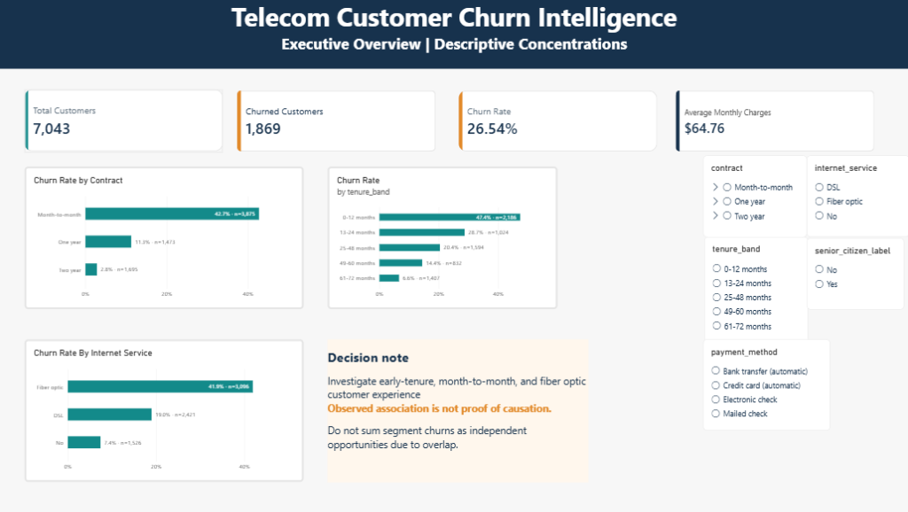
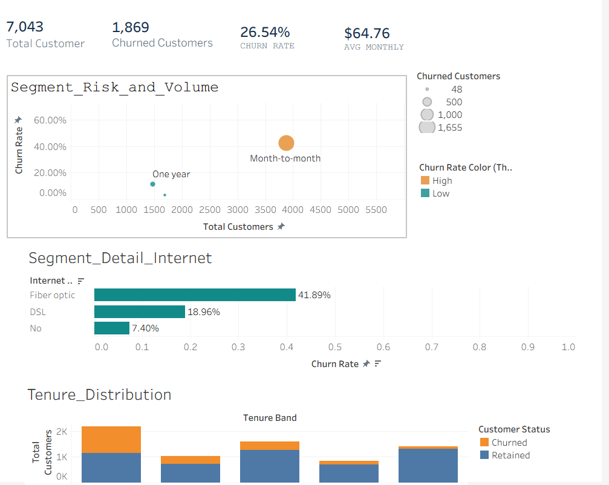
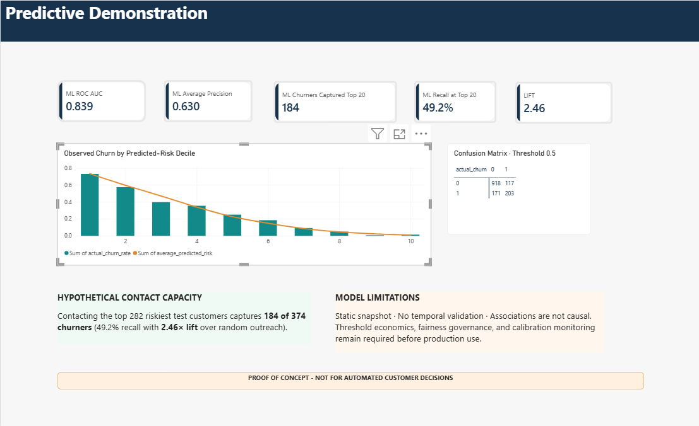
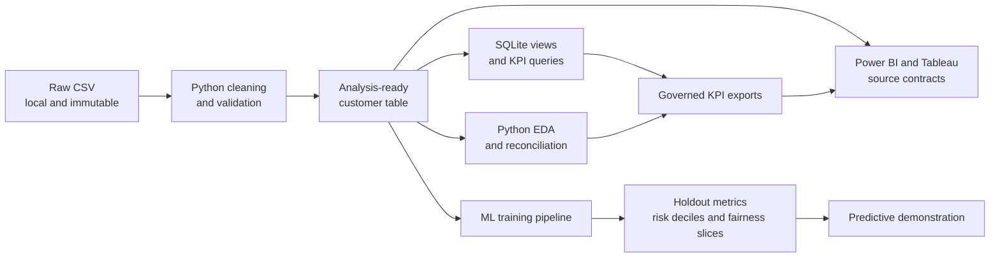

# Telecom Customer Churn Intelligence

An end-to-end analytics portfolio project that turns the IBM Telco Customer Churn sample into governed SQL analysis, reproducible Python EDA, BI-ready semantic definitions, and an explicitly limited machine-learning risk-ranking demonstration.

> **Headline:** 1,869 of 7,043 customers churned (26.537%). Churn is concentrated among early-tenure, month-to-month, fiber-optic, and electronic-check customers. These overlapping observational patterns identify investigation priorities—not causal drivers.

## Business objective

Help a retention team understand where churn is concentrated, select evidence-based investigation priorities, and design a controlled retention experiment. The project separates verified descriptive KPIs from predictive holdout metrics and avoids presenting association as causation.

## Business intelligence dashboards

The project provides interactive implementations in both **Power BI** and **Tableau** sharing the exact same governed metric definitions:

### Power BI: Governed Executive Reporting
- **Workbook:** `powerBI/dashboard.pbix`
- **Pages:** Executive Overview, Segment Explorer, Builder Validation
- **Architecture:** Reusable DAX measures (`DISTINCTCOUNT`, safe `DIVIDE`), synchronized multi-page slicers, and custom palette theme.



### Tableau: Focused Visual Exploration
- **Workbook:** `tableau/dashboard.twb`
- **Dashboard:** Churn Segment Explorer
- **Architecture:** Dual-axis scatter plot (risk vs. scale), lifecycle tenure breakdown, and coordinated interactive filter actions.



## Verified results

| KPI | Result |
|---|---:|
| Customers | 7,043 |
| Churned customers | 1,869 |
| Retained customers | 5,174 |
| Churn rate | 26.537% |
| Total monthly charges | $456,116.60 |
| Average monthly charges | $64.76 |
| Missing total charges | 11 |

Priority evidence:

- Month-to-month: 3,875 customers, 1,655 churned, 42.7% churn.
- First 0–12 months: 2,186 customers, 1,037 churned, 47.4% churn.
- Fiber optic: 3,096 customers, 1,297 churned, 41.9% churn.
- Electronic check: 2,365 customers, 1,071 churned, 45.3% churn.

These segments overlap and must not be added as independent opportunities. See the [executive brief](docs/executive_brief.md) for decisions, limitations, and the proposed experiment.

## Predictive demonstration



Logistic regression is the primary proof-of-concept model, compared with a constrained decision tree. On a stratified 20% holdout containing 1,409 customers:

| Metric | Logistic regression |
|---|---:|
| ROC-AUC | 0.839 |
| Average precision | 0.630 |
| Precision at 0.5 | 63.4% |
| Recall at 0.5 | 54.3% |
| Highest-risk 20% churners captured | 184 of 374 |
| Recall at 20% capacity | 49.2% |
| Lift at 20% capacity | 2.46× |

This is same-population holdout performance from a static snapshot—not future-period validation or a deployment claim. See the [methodology](docs/ml_methodology.md) and [results report](docs/ml_results_report.md).

## Architecture



## Quality controls

- One row per unique customer and zero dropped source rows.
- Eleven blank `TotalCharges` values retained as missing.
- Frozen KPI dictionary shared across SQL, Python, Power BI, and Tableau.
- 107 Python-to-SQL overall and segment comparisons passed.
- Preprocessing fitted only inside ML training pipelines.
- Identifiers and outcome-derived fields excluded from predictors.
- Fixed random seed and reproducible stratified train/test split.
- Automated tests cover data, SQL, EDA, BI assets, ML, and portfolio outputs.

See [cross-tool reconciliation](docs/cross_tool_reconciliation.md) for exact status. Interactive `.pbix` and `.twb` dashboards are fully constructed, interaction-tested, and saved in `powerBI/dashboard.pbix` and `tableau/dashboard.twb` (with underlying specifications preserved in `reports/powerbi/` and `reports/tableau/`).

## Repository map

```text
data/                  Local raw and generated data contracts
docs/                  Dictionaries, QA, methodology, narrative, and runbooks
powerBI/               Interactive Power BI report workbook (dashboard.pbix)
reports/figures/       Verified EDA charts
reports/ml/            Model artifacts, metrics, diagnostics, and exports
reports/powerbi/       Theme, semantic definitions, DAX, specifications, previews
reports/tableau/       Calculated fields, specifications, previews
sql/                   SQLite schema, views, KPIs, segments, and checks
src/                   Reproducible Python pipelines
tableau/               Interactive Tableau workbook (dashboard.twb)
tests/                 Automated validation suite
```

## Reproduce locally

Place the source file at the repository root as `Telco-Customer-Churn.csv`; it is intentionally excluded from Git. Then:

```powershell
python -m venv .venv
.\.venv\Scripts\Activate.ps1
python -m pip install --upgrade pip
python -m pip install -r requirements.txt
python src/project_check.py
python src/data_pipeline.py
python src/sql_pipeline.py
python src/eda_pipeline.py
python src/powerbi_preview.py
python src/tableau_preview.py
python src/ml_pipeline.py
python src/ml_dashboard_preview.py
python -m pytest -q
```

Detailed instructions are in the [reproducibility runbook](docs/reproducibility_runbook.md).

<!-- ## Interview preparation

The [complete interview guide](docs/complete_interview_guide.md) contains 155 beginner-to-intermediate technical, project, general, and behavioral questions with explanatory answers, acronym definitions, speaking scripts, practical SQL/Python exercises, and a focused 15-day study plan. -->

## Responsible interpretation

- Segment differences are associations, not causal effects.
- The data has no observation date or future churn window.
- Random holdout performance may overstate future operational performance.
- Risk ranking must not become automated customer treatment.
- A real program needs controlled experiments, customer-value economics, fairness governance, security, temporal validation, drift monitoring, and calibration monitoring.

## Current status

All analytical, modeling, documentation, and interactive BI dashboard work is complete. Both the Power BI (`powerBI/dashboard.pbix`) and Tableau (`tableau/dashboard.twb`) interactive workbooks have been verified, cross-reconciled, and saved.
